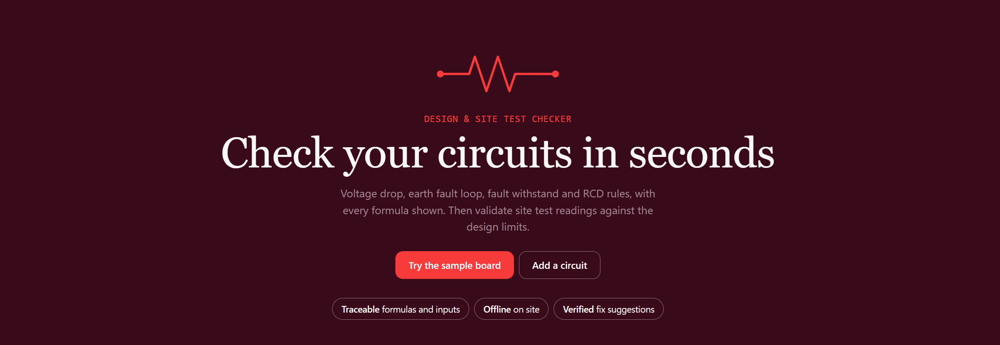
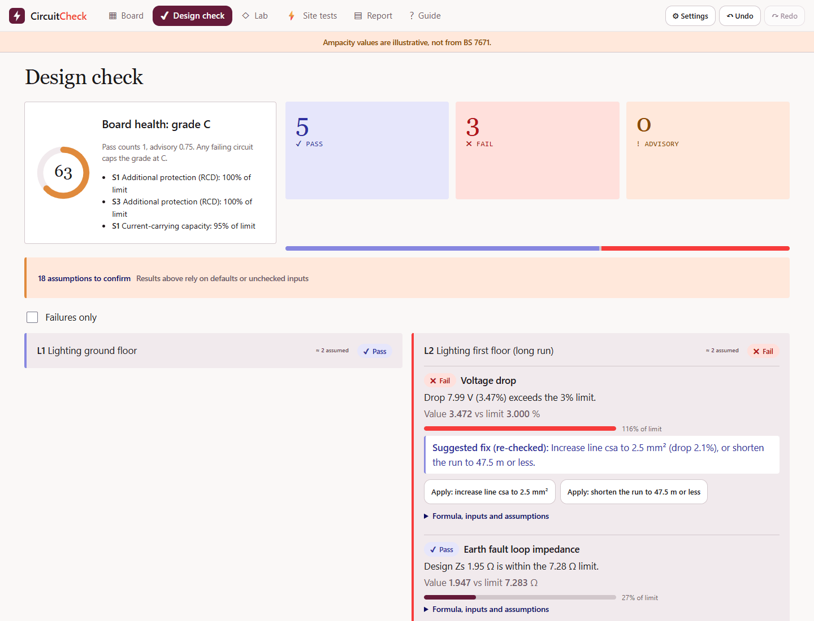
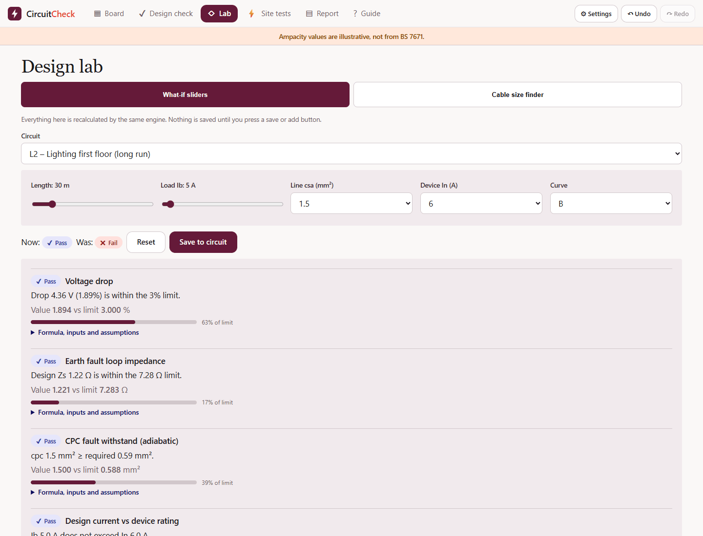
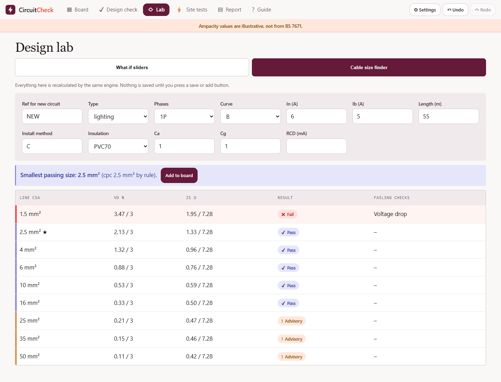
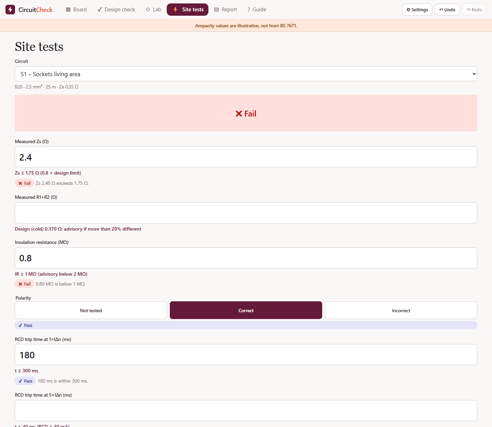
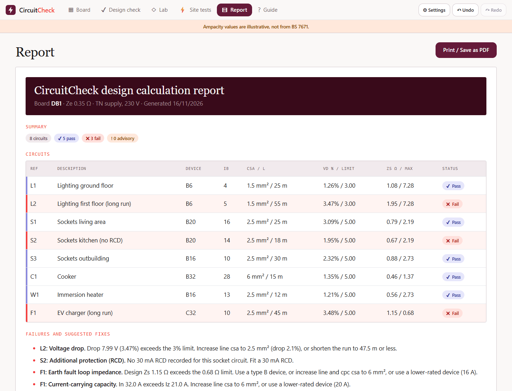
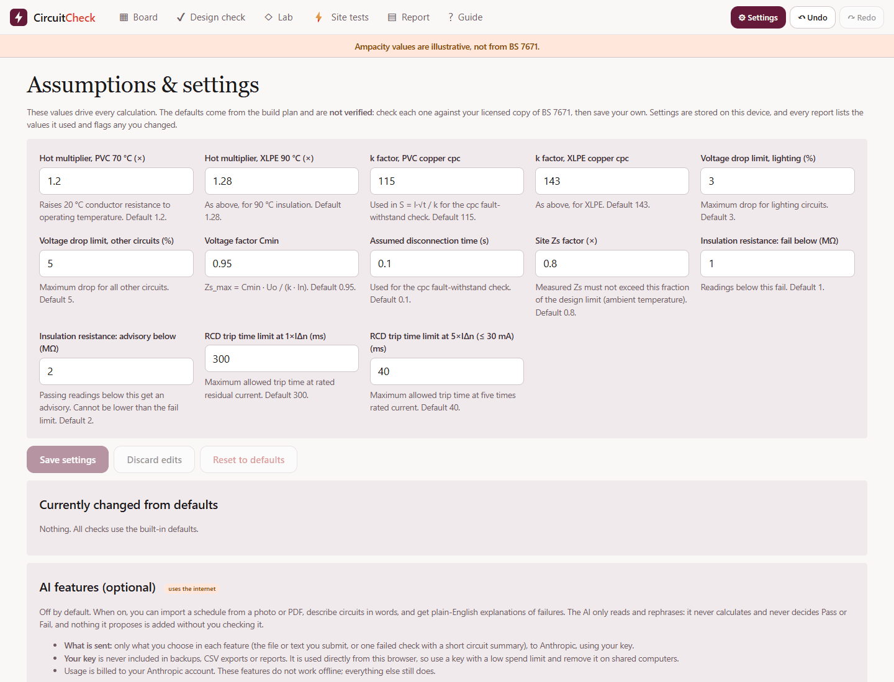
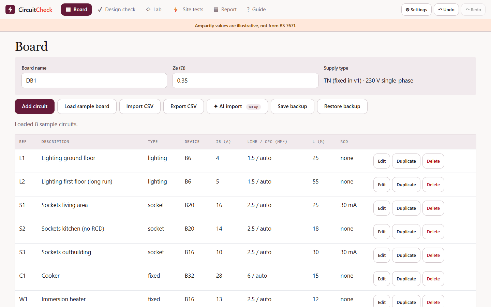
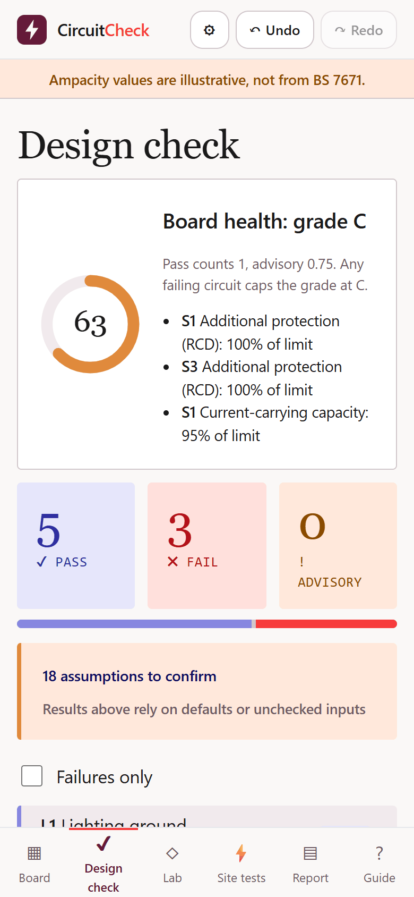
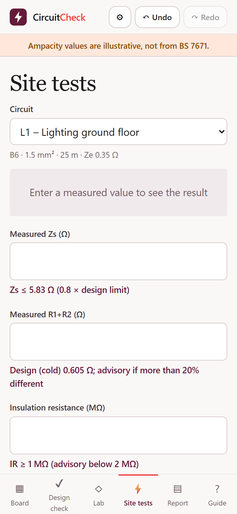

# CircuitCheck

<p align="center">
  <a href="https://habibullahmanzoor.github.io/circuitcheck/">
    
  </a>
</p>
<p align="center">
  <a href="https://habibullahmanzoor.github.io/circuitcheck/"><b>Open the live demo</b></a>
  &nbsp;·&nbsp; works offline &nbsp;·&nbsp; deterministic, tested engine &nbsp;·&nbsp; design aid only
</p>

An offline-capable web app that checks low-voltage final-circuit designs against BS 7671-style rules and validates site test results against the design limits. Every result carries its formula, inputs, assumptions and clause reference.

> **Design aid only.** Results depend on the inputs and assumptions listed. This tool is not a substitute for the judgement and sign-off of a competent person. It does not produce certificates and gives no compliance guarantee.

- Live demo: https://habibullahmanzoor.github.io/circuitcheck/
- CI: workflows are in [docs/ci/](docs/ci/) (typecheck, tests, build, Pages deploy). Copy them to `.github/workflows/` to enable them; pushing workflow files needs the GitHub `workflow` token scope.
## Screenshots

The screenshots use the built-in sample board, which contains three deliberate failures (a long lighting run, a socket circuit with no RCD, and a long C32 run).

<p align="center">
  
</p>
<p align="center"><em>Design check: board health score, pass/fail tiles, and each failure with its numbers, formula and an engine-verified fix you can apply in one click.</em></p>

<table>
  <tr>
    <td width="50%"><br><sub><b>What-if lab.</b> Drag length, load, size or breaker and every check recalculates live. L2 flips from Fail to Pass at 30 m.</sub></td>
    <td width="50%"><br><sub><b>Cable size finder.</b> Tries every standard size and marks the smallest that passes all checks.</sub></td>
  </tr>
  <tr>
    <td width="50%"><br><sub><b>Site tests.</b> Large inputs, limits beside each field, and an instant verdict as you type.</sub></td>
    <td width="50%"><br><sub><b>Report.</b> Printable A4 summary with failures, fixes, test results, settings used and assumptions.</sub></td>
  </tr>
  <tr>
    <td width="50%"><br><sub><b>Assumptions &amp; settings.</b> Every constant is editable, validated, saved, and printed in reports with changes flagged.</sub></td>
    <td width="50%"><br><sub><b>Board.</b> Circuit schedule with CSV import/export, backup and restore, undo and redo.</sub></td>
  </tr>
</table>

<p align="center">
  
  &nbsp;&nbsp;
  
</p>
<p align="center"><em>Mobile-first: bottom navigation, 44 px tap targets, and an offline PWA for use on site.</em></p>

See also the in-app [Guide](docs/screenshots/guide.png) tab and the [welcome screen](docs/screenshots/welcome.png). A demo GIF of the full flow has not been recorded yet.

## What it checks

Clause references are free text. **Verify them against your licensed copy of BS 7671.**

| Rule | Formula | Clause (verify) |
|---|---|---|
| Voltage drop | 1φ `Vd = 2·r_hot·L·Ib`; 3φ `Vd = √3·r_hot·L·Ib`; limit 3% lighting, 5% other | App 4 / Reg 525 |
| Earth fault loop | `Zs = Ze + (R1+R2)_hot ≤ Cmin·Uo/(k·In)`, k = 5/10/20 for B/C/D | Ch 41 |
| CPC fault withstand | `S_min = I_pf·√t / k`, `I_pf = Uo / Zs_cold`, t = 0.1 s | Reg 543.1 |
| Ib ≤ In ≤ Iz | `Iz = It·Ca·Cg` from a pluggable table | App 4 |
| Additional protection | socket circuits ≤ 32 A need ≤ 30 mA RCD | Reg 411.3.3 |
| Site tests | Zs ≤ 0.8·limit; IR ≥ 1 MΩ (advisory < 2); RCD ≤ 300 ms (≤ 40 ms at 5× for ≤ 30 mA); polarity; consistency checks | Part 6 / GN3 |

## Features beyond the checks

- **Apply fix, with Undo:** every suggestion is re-checked by the engine; one click applies it.
- **Lab tab:** what-if sliders for length, load, csa, breaker and curve, plus a cable size finder that reports the smallest passing size.
- **Board health:** a 0-100 score and grade (any failure caps it at C) with the tightest margins listed.
- **Site test sessions:** dated history per circuit, change since the previous test, CSV export.
- **Assumptions & settings (⚙):** every tunable assumption (hot multipliers, k factors, voltage-drop limits, Cmin, disconnection time, site Zs factor, insulation and RCD limits) is editable, validated, saved on the device, and printed in every report with changes flagged. Defaults are unverified, so confirm them against your licensed copy.
- **Undo / redo** (Ctrl+Z / Ctrl+Y) for board edits, and **backup / restore** of the whole board as a JSON file.

## How it's validated

Golden values are derived by hand from the formulas and asserted in `src/engine/__tests__`. See [docs/VALIDATION.md](docs/VALIDATION.md) for each value and its origin. There are also deterministic property tests (monotonicity, no `NaN`), CSV round-trip tests, and render tests for the UI. Engine line coverage is 100% (`npm run coverage`, gate ≥ 90%).

## Architecture

Engine ← UI, pure and deterministic. See [docs/ARCHITECTURE.md](docs/ARCHITECTURE.md). **No LLM does any arithmetic.** Decisions are logged in [docs/DECISIONS.md](docs/DECISIONS.md).

## Run it

```
npm install
npm run dev        # development
npm test           # tests
npm run coverage   # tests + coverage
npm run build      # typecheck + production build
```

## Limitations and non-goals

- Single-phase TN supplies are the focus; three-phase is balanced-load voltage drop only. No unbalanced loads, harmonics, breaking-capacity coordination, cable routing, accounts or backend.
- Voltage drop is resistive only (an advisory appears at ≥ 25 mm²).
- Fault withstand assumes a fixed disconnection time (0.1 s), not manufacturer let-through I²t.
- Constants marked `TODO(verify)` (hot multipliers, k factors, limits) come from the build plan and have not been checked against a licensed copy.
- **The bundled ampacity table is synthetic and illustrative.** It is generated by a formula, is not taken from BS 7671, and the app shows a banner while it is active.
- **Copyright:** BS 7671, GN3 and the On-Site Guide tables are copyrighted and are not reproduced here.
- Offline use was verified once in headless Edge: after a first visit, with the server stopped, the app reloaded from the service worker cache with saved circuits intact. PNG icons (192/512, maskable) and a manifest are included. A full Lighthouse PWA audit has not been run; do that yourself before relying on installability.

## Using a licensed ampacity table

Create `src/data/ampacity.local.json` (git-ignored). If present and valid it replaces the demo table and the banner disappears if `demo` is not `true`.

```json
{
  "name": "My licensed table",
  "demo": false,
  "entries": [
    { "csaMm2": 2.5, "installMethod": "C", "insulation": "PVC70", "phases": "1P", "itA": 0 }
  ]
}
```

Replace `itA` with your own values. A missing entry makes that circuit's ampacity check `NOT_CHECKED`; it never guesses.

## CSV format

`ref,description,phases,kind,device,inA,ibA,lineCsaMm2,cpcCsaMm2,insulation,lengthM,installMethod,ambientFactor,groupingFactor,rcdMa`. See `src/data/sample-board.csv`. Bad rows are reported with their row number and the other rows still load.

## Roadmap (not in v1)

- LLM-assisted schedule extraction from a photo or PDF, with mandatory human confirmation of every field before it reaches the engine.
- Manufacturer let-through I²t, reactance for large csa, three-phase unbalanced, RCBO/fuse curves.
- Site temporary supply demand estimate by build phase (separate module).
- Backend sync and multi-user.

_Inputs that rely on defaults (blank cpc, Ca = Cg = 1, no ampacity entry, placeholder Ze, demo table) are listed under **assumptions to confirm** on the Design check tab and in every report._

## Optional AI features (bring your own key)

Off by default. In Settings you can add an Anthropic API key to enable: **AI import** (photo/PDF or plain-words description to proposed circuit rows, each of which you must check and tick before it is added), and **Explain in plain English** for failed checks. The AI only reads and rewords: it never calculates, never decides Pass/Fail and never supplies standards values, so the deterministic engine is unchanged. Only what you submit is sent to Anthropic; the key is kept out of backups, exports and reports (tab-only by default). The SDK and zod load lazily, so the offline core does not use them. These features need internet and are billed to your key. They are tested with mocked API replies; they have not been run against the live API in this repo.
